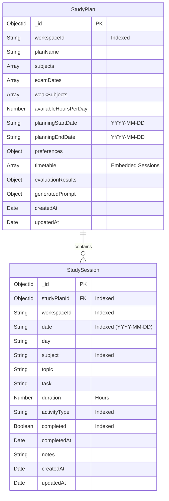

# DATABASE SCHEMA DOCUMENTATION

This document provides complete technical specifications for the MongoDB Atlas database models, schemas, field types, constraints, indexes, and entity relationships implemented via **Mongoose v9**.

Database Name: `study_planner`

---

## 1. Entity Relationship Diagram (ERD)



---

## 2. Collection Specifications

### 2.1 `StudyPlan` Collection

The `StudyPlan` collection stores the top-level configuration, student constraints, embedded schedule items, prompt engineering metadata, and rule evaluation scores.

| Field Name | Type | Required | Default | Description / Constraints |
| :--- | :--- | :--- | :--- | :--- |
| `_id` | `ObjectId` | Yes | Auto | Unique MongoDB Document ID |
| `workspaceId` | `String` | Yes | `'default-student-workspace'` | Anonymous workspace identifier for partitioning student data |
| `planName` | `String` | Yes | `'Personalized Exam Study Plan'` | User-defined title for the plan |
| `subjects` | `[SubjectSchema]` | Yes | `[]` | Array of subjects with difficulty and topic lists |
| `examDates` | `[ExamDateSchema]` | No | `[]` | Array of examination deadlines per subject |
| `weakSubjects` | `[String]` | No | `[]` | List of subject names requiring preferential 1.35x-1.5x allocation |
| `availableHoursPerDay` | `Number` | Yes | `4` | Maximum allowable daily study duration ($1 \le h \le 16$) |
| `planningStartDate` | `String` | Yes | - | Planning window start date in `YYYY-MM-DD` |
| `planningEndDate` | `String` | Yes | - | Planning window end date in `YYYY-MM-DD` |
| `preferences` | `PreferenceSchema` | No | `{}` | Student preferences for session duration and techniques |
| `timetable` | `[TimetableItemSchema]` | No | `[]` | Embedded array of scheduled sessions for fast aggregate retrieval |
| `evaluationResults` | `EvaluationResultsSchema` | No | `{}` | Complete 8-rule evaluation breakdown and deterministic scores |
| `generatedPrompt` | `GeneratedPromptSchema` | No | `{}` | Full audit copy of system prompt, user prompt, token metrics, and latency |
| `createdAt` | `Date` | Auto | `Date.now` | Document creation timestamp |
| `updatedAt` | `Date` | Auto | `Date.now` | Document last modified timestamp |

#### Sub-Schemas within `StudyPlan`

##### `SubjectSchema` (`_id: false`)
- `name`: `String` (Required, Trimmed)
- `difficulty`: `String` (Enum: `['Easy', 'Medium', 'Hard']`, Default: `'Medium'`)
- `topics`: `[String]` (List of individual syllabus topics)

##### `ExamDateSchema` (`_id: false`)
- `subject`: `String` (Required, Trimmed)
- `examDate`: `String` (Required, Format: `YYYY-MM-DD`)

##### `PreferenceSchema` (`_id: false`)
- `preferredSessionDuration`: `Number` (Minutes: 30, 45, 60, 90, 120; Default: 60)
- `studyTimeOfDay`: `String` (Enum: `['Morning', 'Afternoon', 'Evening', 'Flexible']`, Default: `'Flexible'`)
- `techniques`: `[String]` (e.g. `'Active Recall'`, `'Spaced Repetition'`, `'Pomodoro'`)
- `revisionIntensity`: `String` (Enum: `['Standard', 'High', 'Intensive']`, Default: `'Standard'`)
- `practiceRequirement`: `Boolean` (Default: `true`)
- `revisionRequirement`: `Boolean` (Default: `true`)

##### `EvaluationResultsSchema` (`_id: false`)
- `overallScore`: `Number` ($0 \text{ to } 100$)
- `feasibilityScore`: `Number` ($0 \text{ to } 100$)
- `completenessScore`: `Number` ($0 \text{ to } 100$)
- `consistencyScore`: `Number` ($0 \text{ to } 100$)
- `hourSatisfactionScore`: `Number` ($0 \text{ to } 100$)
- `examComplianceScore`: `Number` ($0 \text{ to } 100$)
- `revisionCoverageScore`: `Number` ($0 \text{ to } 100$)
- `practiceCoverageScore`: `Number` ($0 \text{ to } 100$)
- `weakSubjectPrioritizationScore`: `Number` ($0 \text{ to } 100$)
- `metrics`: Array of `{ rule, name, score, status, details, mathExplanation }`
- `warnings`: `[String]`
- `recommendations`: `[String]`
- `evaluatedAt`: `Date`

##### `GeneratedPromptSchema` (`_id: false`)
- `systemPrompt`: `String`
- `userPrompt`: `String`
- `fullPrompt`: `String`
- `modelUsed`: `String` (Default: `'gemini-3.5-flash-lite'`)
- `rawResponseText`: `String`
- `promptTokensEstimate`: `Number`
- `responseTokensEstimate`: `Number`
- `latencyMs`: `Number`
- `generatedAt`: `Date`

---

### 2.2 `StudySession` Collection

The `StudySession` collection represents normalized study activities, allowing fine-grained updates, progress tracking, and daily aggregations.

| Field Name | Type | Required | Default | Description / Constraints |
| :--- | :--- | :--- | :--- | :--- |
| `_id` | `ObjectId` | Yes | Auto | Unique MongoDB Document ID |
| `studyPlanId` | `ObjectId` | Yes | - | Foreign Key reference to parent `StudyPlan` |
| `workspaceId` | `String` | Yes | `'default-student-workspace'` | Workspace partition key |
| `date` | `String` | Yes | - | Session date in `YYYY-MM-DD` |
| `day` | `String` | Yes | - | Day of week (`Monday`, `Tuesday`, etc.) |
| `subject` | `String` | Yes | - | Name of the subject being studied |
| `topic` | `String` | Yes | - | Specific concept or unit to master |
| `task` | `String` | Yes | - | Actionable description of the study activity |
| `duration` | `Number` | Yes | `1.0` | Session length in hours ($0.25 \le \text{duration} \le 12$) |
| `activityType` | `String` | Yes | `'Learning'` | Enum: `['Learning', 'Revision', 'Practice', 'Self-assessment']` |
| `completed` | `Boolean` | Yes | `false` | Whether session has been accomplished |
| `completedAt` | `Date` | No | `null` | Timestamp when marked completed |
| `notes` | `String` | No | `''` | Student personal notes on session |
| `createdAt` | `Date` | Auto | `Date.now` | Creation timestamp |
| `updatedAt` | `Date` | Auto | `Date.now` | Last update timestamp |

---

## 3. Database Indexes

To ensure high-throughput querying across student plans and dashboard aggregations, the following indexes are declared:

### `StudyPlan` Indexes
```javascript
// Workspace query index: rapid retrieval of user plans sorted by newest
StudyPlanSchema.index({ workspaceId: 1, createdAt: -1 });

// Date boundary index: range queries across academic calendar
StudyPlanSchema.index({ planningStartDate: 1, planningEndDate: 1 });
```

### `StudySession` Indexes
```javascript
// Plan and date lookup index: fast retrieval of sessions for a timetable
StudySessionSchema.index({ studyPlanId: 1, date: 1 });

// Workspace completion index: aggregates completed hours for dashboard
StudySessionSchema.index({ workspaceId: 1, completed: 1 });

// Subject index: aggregates subject-wise mastery
StudySessionSchema.index({ subject: 1 });

// Single date index: daily schedule view
StudySessionSchema.index({ date: 1 });
```

---

## 4. Referential Integrity & Cascade Deletion

- **Cascade Delete:** When a `StudyPlan` is deleted via `DELETE /api/study-plans/:id`, the controller automatically executes:
  ```javascript
  await StudySession.deleteMany({ studyPlanId: req.params.id });
  ```
  This guarantees that orphan sessions never remain in the database.
- **Bi-directional Synchronization:** Marking a session completed in `StudySession` updates the corresponding item inside `StudyPlan.timetable` and triggers re-computation of parent plan progress.
