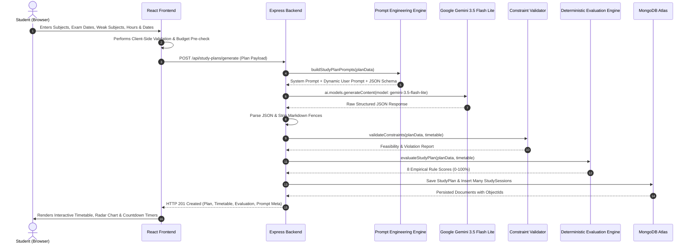

# PROJECT WORKFLOW: AI-POWERED PERSONALIZED STUDY PLAN GENERATOR

This document details the complete end-to-end operational workflow of the application, tracing data from student requirement intake through prompt engineering, Gemini AI synthesis, constraint validation, database persistence, and user interface rendering.

---

## 1. High-Level Workflow Overview



---

## 2. Step-by-Step Detailed Process

### Step 1: Student Input Collection & Real-Time Client Validation
1. **Curriculum Intake:** The student inputs the list of subjects (e.g., DSA, DBMS, OS, NLP), their perceived difficulty (Easy, Medium, Hard), and individual topics.
2. **Examination Schedule:** Examination dates are assigned to each subject. The UI enforces that exam dates cannot be earlier than the planning start date.
3. **Weak Subject Prioritization:** The student flags difficult subjects as "Weak". This triggers a preferential weighting flag.
4. **Temporal Boundaries & Capacity:** Start and End dates determine total calendar days. The daily hour slider ($1 \text{ to } 16\text{ hours/day}$) computes the total study budget:
   $$\text{Total Available Study Budget} = \text{Total Calendar Days} \times \text{Available Hours Per Day}$$
5. **Pre-Submission Check:** If total hours are inadequate for the number of subjects, the UI issues a real-time warning before submission.

### Step 2: Payload Transmission to Backend
The client dispatches an HTTP POST request to `/api/study-plans/generate` containing:
```json
{
  "workspaceId": "student-workspace-01",
  "planName": "University Semester Finals Preparation Plan",
  "planningStartDate": "2026-10-12",
  "planningEndDate": "2026-10-19",
  "availableHoursPerDay": 4,
  "weakSubjects": ["DBMS"],
  "subjects": [
    { "name": "DSA", "difficulty": "Hard", "topics": ["Dynamic Programming", "Graphs"] },
    { "name": "DBMS", "difficulty": "Hard", "topics": ["Normalization", "ACID Transactions"] },
    { "name": "OS", "difficulty": "Medium", "topics": ["Process Scheduling", "Deadlocks"] },
    { "name": "NLP", "difficulty": "Medium", "topics": ["Transformers", "Attention"] }
  ],
  "examDates": [
    { "subject": "DSA", "examDate": "2026-10-20" },
    { "subject": "DBMS", "examDate": "2026-10-24" },
    { "subject": "OS", "examDate": "2026-10-28" },
    { "subject": "NLP", "examDate": "2026-11-02" }
  ],
  "preferences": {
    "preferredSessionDuration": 60,
    "studyTimeOfDay": "Flexible",
    "revisionIntensity": "High",
    "practiceRequirement": true,
    "revisionRequirement": true
  }
}
```

### Step 3: Backend Input Verification & Model Pre-Flight
- `backend/middleware/validator.js` inspects parameters for data hygiene.
- `backend/config/gemini.js` verifies that `GEMINI_MODEL=gemini-3.5-flash-lite` is configured and active. As per prompt requirements, another model is never silently substituted.

### Step 4: Dynamic Prompt Construction
`backend/prompts/studyPlanPrompt.js` executes:
1. **Persona & Cognitive Scientist Framing:** Instantiates Gemini as an elite Academic Scheduling Architect.
2. **Hard Constraint Mandates:**
   - Daily hours must strictly $\le$ `availableHoursPerDay`.
   - No preparation sessions on or after an examination date.
   - All session dates must fall strictly between start and end dates.
3. **Cognitive Distribution Directive:**
   - 45-50% Learning (concept acquisition).
   - 25-30% Revision (active recall & summaries).
   - 15-20% Practice (problem solving).
   - 5-10% Self-Assessment (mock exams).
4. **Weak Subject Prioritization Multiplier:** Mandates at least 30-40% more study hours for weak subjects.
5. **Strict JSON Schema Enforcement:** Directs output to pure JSON without markdown code fences.

### Step 5: Gemini AI Execution
- The prompt is transmitted via the official `@google/genai` SDK using `ai.models.generateContent`.
- Generation latency and token consumption metrics are measured.
- The raw string response is cleaned of any residual markdown delimiters and parsed via `JSON.parse()`.

### Step 6: Independent Constraint Validation
`backend/services/schedulerEngine.js` verifies the generated schedule independently:
- Loops over every session to ensure:
  $$\text{Session Date} \ge \text{Planning Start Date} \quad \text{and} \quad \text{Session Date} \le \text{Planning End Date}$$
- Ensures for every subject session:
  $$\text{Session Date} < \text{Exam Date of Subject}$$
- Verifies daily total durations:
  $$\sum \text{Session Duration on Day } D \le \text{Available Hours Per Day}$$
- If violations occur, they are recorded in the validation report.

### Step 7: Deterministic Rule-Based Performance Evaluation
`backend/services/evaluationEngine.js` computes 8 mathematical rule scores:
1. Feasibility (workload cap compliance).
2. Completeness (subject and activity diversity).
3. Consistency (temporal validity & day name sync).
4. Hour Satisfaction (% days meeting study hour cap).
5. Exam Compliance (zero sessions on/after exam).
6. Revision Coverage (% subjects with spaced revision).
7. Practice Coverage (% subjects with problem sets).
8. Weak Subject Prioritization (time ratio $\ge 1.25\times$).
- Calculates the final composite score ($0-100\%$).

### Step 8: Database Storage (Mongoose & MongoDB Atlas)
1. A new `StudyPlan` document is created in MongoDB containing the plan metadata, the embedded timetable array, prompt metadata, and evaluation results.
2. An array of `StudySession` documents is created and batch-inserted (`insertMany()`) with references to the parent `studyPlanId`.
3. ObjectIds from the inserted sessions are mapped back into the parent plan timetable.

### Step 9: Frontend Display & Student Interaction
1. The client receives the HTTP 201 response and redirects to `/timetable`.
2. The student interacts with the schedule:
   - **Table & Daily Views:** Toggle between full tabular layout and day-by-day cards.
   - **Real-Time Completion:** Checking a session sends a PATCH request to `/api/sessions/:id/complete`, triggers confetti celebration, and updates progress bars.
   - **Live Editing:** Edit session modal updates topic, task, and duration, syncing with MongoDB.
   - **Prompt Engineering Inspection:** Navigate to `/prompt-analysis` to view the exact prompts, LLM response, and 8-rule radar chart.
   - **PDF Generation:** Click "Download PDF Timetable" to produce a vector academic timetable PDF.
