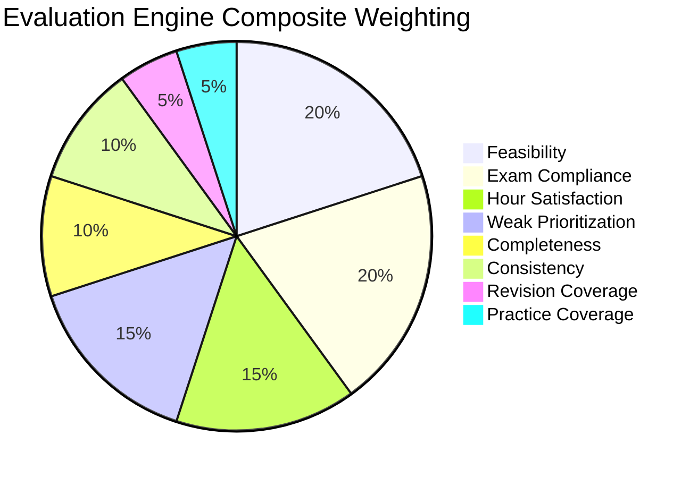

# PROMPT ENGINEERING & EVALUATION FRAMEWORK

This document provides an in-depth analysis of the prompt engineering techniques, cognitive science principles, system prompt designs, and deterministic validation rules implemented in the **AI-Powered Personalized Study Plan Generator**.

---

## 1. Rationale: Why Prompt Engineering Matters for Scheduling

Generating an academic study schedule is not a creative writing task; it is a **multi-constraint optimization problem**. If an LLM is prompted naively (e.g. *"Create a study timetable for my 4 exams"*), it frequently exhibits critical failure modes:
1. **Hallucination of Time:** Over-allocates hours on single days (e.g., 7 hours on a day budgeted for 4).
2. **Post-Exam Preparation:** Schedules revision for a subject *after* that subject's exam has passed.
3. **Passive Monotony:** Generates 100% reading sessions with zero revision or problem solving.
4. **Symmetric Blindness:** Gives identical time to easy and weak subjects.

To solve this, our system employs an advanced **Context-Grounded Prompt Engineering Architecture**.

---

## 2. Core Prompt Engineering Techniques Implemented

### 2.1 Persona & Role Framing
We ground the LLM in an authoritative identity:
```text
You are an elite Academic Scheduling Architect and Cognitive Learning Scientist 
specializing in high-stakes university examination preparation.
```
This primes Gemini to apply cognitive load theories, spaced repetition, and systematic pacing rather than casual advice.

### 2.2 Hierarchical Constraint Separation (Hard vs Soft Constraints)
We clearly delineate constraints into two strict categories:
- **Hard Constraints (Zero-Tolerance Rules):**
  - Daily hour ceiling: $\sum \text{Durations} \le \text{availableHoursPerDay}$ on every single day.
  - Exam deadlines: Never schedule preparation on or after that subject's exam date.
  - Planning window: All sessions must fall strictly between start and end dates.
- **Soft Constraints (Optimization Targets):**
  - Preferred single session duration (e.g., 60 minutes).
  - Preferred study time of day (e.g., Morning, Flexible).
  - Spaced revision loops.

### 2.3 Contextual Grounding & Dynamic Mathematical Bounds
The prompt constructor calculates the exact calendar span before formulating the prompt:
- Calculates `totalDays = (endDate - startDate) + 1`.
- Calculates `totalAvailableHours = totalDays * availableHoursPerDay`.
- Injects these numbers into the prompt so Gemini does not have to compute calendar arithmetic from scratch.

### 2.4 Weak Subject Bias Induction
The prompt detects weak subjects (e.g. `DBMS`) and explicitly tags them:
```text
- Weak Subject Status: CRITICAL / WEAK SUBJECT 
  (Requires minimum 35% more time and focused revision)
```
This forces the attention mechanism to prioritize weak subjects during slot rotation.

### 2.5 4-Tier Pedagogical Composition
The prompt explicitly mandates four activity types with target percentages:
1. **Learning (45-50%):** Core conceptual acquisition and theory deep-dives.
2. **Revision (25-30%):** Active recall, summary consolidation, and mind mapping.
3. **Practice (15-20%):** Solving numericals, past exam questions, and coding problems.
4. **Self-Assessment (5-10%):** Timed mock tests and error log analysis.

### 2.6 Strict Output Schema & Markdown Elimination
The prompt mandates pure parseable JSON adhering to an exact schema without wrapping markdown fences (` ```json `), ensuring predictable parsing.

---

## 3. The Prompt Templates

### System Prompt
```text
You are an elite Academic Scheduling Architect and Cognitive Learning Scientist specializing in high-stakes university examination preparation.
Your objective is to generate an optimal, mathematically feasible, personalized study timetable tailored strictly to student constraints.

### SYSTEM RULES & HARD CONSTRAINTS:
1. DAILY HOUR CEILING: The total session duration on ANY single day MUST NOT exceed {availableHoursPerDay} hours. Never over-schedule a single minute.
2. EXAM DEADLINE COMPLIANCE: NEVER schedule study or revision for a subject on or after its examination date. All preparation for a subject must strictly complete before that subject's exam.
3. PLANNING BOUNDARIES: Timetable sessions MUST occur strictly between {planningStartDate} and {planningEndDate} inclusive. No dates before {planningStartDate} or after {planningEndDate}.
4. WEAK SUBJECT PRIORITIZATION: Weak subjects ({weakSubjects}) MUST receive preferential allocation (at least 30-40% higher cumulative hours) and additional active revision sessions.
5. PEDAGOGICAL COMPOSITION: Distribute sessions across 4 mandatory activity types:
   - "Learning": Core concept acquisition and topic deep-dives (~45-50% of time)
   - "Revision": Active recall, mind-mapping, summary consolidation (~25-30% of time)
   - "Practice": Problem-solving, past year questions, numericals (~15-20% of time)
   - "Self-assessment": Timed mock tests, self-quizzing (~5-10% of time)
6. SESSION DURATIONS: Preferred session duration is {preferredSessionDuration} minutes. Standard sessions should typically be 1.0, 1.5, or 2.0 hours.
7. FEASIBILITY CHECK: Calculate daily sum of hours explicitly. If the planning duration ({totalDays} days, {totalAvailableHours} total available hours) is tight for the requested syllabus, prioritize upcoming examinations first, followed by weak subjects.

### OUTPUT FORMAT:
You MUST respond with a VALID, RAW JSON object ONLY.
Do NOT enclose the JSON in markdown code blocks like ```json. Output pure parseable JSON.
```

### Dynamic User Prompt
```text
### STUDENT STUDY PLAN SPECIFICATIONS

Plan Title: "{planName}"
Planning Window: {planningStartDate} to {planningEndDate} ({totalDays} total calendar days)
Daily Study Capacity: {availableHoursPerDay} hours per day (Total budget: {totalAvailableHours} hours)
Preferred Single Session Duration: {preferredSessionDuration} minutes
Preferred Time of Day: {studyTimeOfDay}
Active Techniques: {techniques}
Revision Requirement: {revisionRequirement}
Practice Requirement: {practiceRequirement}

### EXAMINATION DATES:
{formattedExams}

### DETAILED SUBJECT BREAKDOWN:
{formattedSubjects}

### WEAK SUBJECTS (HIGH PRIORITY):
{weakSubjects}

### INSTRUCTIONS FOR REASONING & OUTPUT GENERATION:
1. First, verify the calendar from {planningStartDate} to {planningEndDate}. Ensure every day has a schedule that does not exceed {availableHoursPerDay} hours.
2. Ensure subjects with earlier examination dates are completed before their exam day.
3. Ensure weak subjects receive deeper practice and spaced revision.
4. Provide structured JSON adhering exactly to the following schema:
...
```

---

## 4. Rule-Based Deterministic Evaluation Engine

The application rejects subjective or randomly generated evaluation scores. Every timetable is subjected to deterministic mathematical verification across **8 dimensions**:



### 1. Feasibility Evaluation (Weight: 20%)
- **Objective:** Assesses whether any calendar day exceeds the daily study budget.
- **Formula:**
  $$\text{Score} = \max\left(0, 100 - \left(\frac{\text{violatingDays}}{\text{totalDays}} \times 40 + \min(40, \text{maxExcess} \times 15)\right)\right)$$
- **Status:** PASS ($\ge 90\%$), WARNING ($70-89\%$), FAIL ($< 70\%$).

### 2. Completeness Evaluation (Weight: 10%)
- **Objective:** Verifies that all requested subjects are covered and all 4 pedagogical activity types exist.
- **Formula:**
  $$\text{Score} = \left(\frac{\text{coveredSubjects}}{\text{totalSubjects}} \times 60\right) + \left(\frac{\text{activitiesPresent}}{4} \times 40\right)$$

### 3. Consistency Evaluation (Weight: 10%)
- **Objective:** Verifies temporal boundaries and calendar day synchronization.
- **Formula:**
  $$\text{Score} = \left(\frac{\text{sessionsInRange}}{\text{totalSessions}} \times 70\right) + \left(\frac{\text{sessionsWithValidDayLabel}}{\text{totalSessions}} \times 30\right)$$

### 4. Study-Hour Constraint Satisfaction (Weight: 15%)
- **Objective:** Evaluates the percentage of scheduled days that strictly satisfy the daily hours constraint.
- **Formula:**
  $$\text{Score} = \left(\frac{\text{compliantDays}}{\text{totalScheduledDays}}\right) \times 100$$

### 5. Examination Date Compliance (Weight: 20%)
- **Objective:** Strictly checks that no session is scheduled on or after that subject's exam date.
- **Formula:**
  $$\text{Score} = \left(\frac{\text{sessionsScheduledBeforeExamDate}}{\text{totalSessions}}\right) \times 100$$

### 6. Revision Coverage (Weight: 5%)
- **Objective:** Assesses the coverage of spaced revision sessions across subjects and total hours.
- **Formula:**
  $$\text{Score} = \min\left(100, \left(\frac{\text{subjectsWithRevision}}{\text{totalSubjects}} \times 60\right) + \min\left(40, \frac{\text{revisionHourRatio}}{0.25} \times 40\right)\right)$$

### 7. Practice & Assessment Coverage (Weight: 5%)
- **Objective:** Assesses the proportion of time dedicated to problem solving and mock tests.
- **Formula:**
  $$\text{Score} = \min\left(100, \left(\frac{\text{subjectsWithPractice}}{\text{totalSubjects}} \times 60\right) + \min\left(40, \frac{\text{practiceHourRatio}}{0.20} \times 40\right)\right)$$

### 8. Weak Subject Prioritization (Weight: 15%)
- **Objective:** Verifies that weak subjects receive at least 1.25x the average hours of normal subjects.
- **Formula:**
  $$\text{Priority Ratio} = \frac{\text{Average Hours per Weak Subject}}{\text{Average Hours per Normal Subject}}$$
  $$\text{Score} = \min\left(100, \max\left(30, \frac{\text{Priority Ratio}}{1.25} \times 100\right)\right)$$

### Composite Overall Score
$$\text{Overall Score} = \sum_{i=1}^{8} (\text{Score}_i \times \text{Weight}_i)$$

---

## 5. Inspection & Auditability

Students can navigate to the **Prompt Analysis** page (`/prompt-analysis`) in the application to:
1. Inspect the exact system prompt and user prompt sent to Gemini.
2. View the raw JSON model response, token estimates, and API latency.
3. Review the Radar Chart and empirical mathematical breakdown for all 8 evaluation rules.
