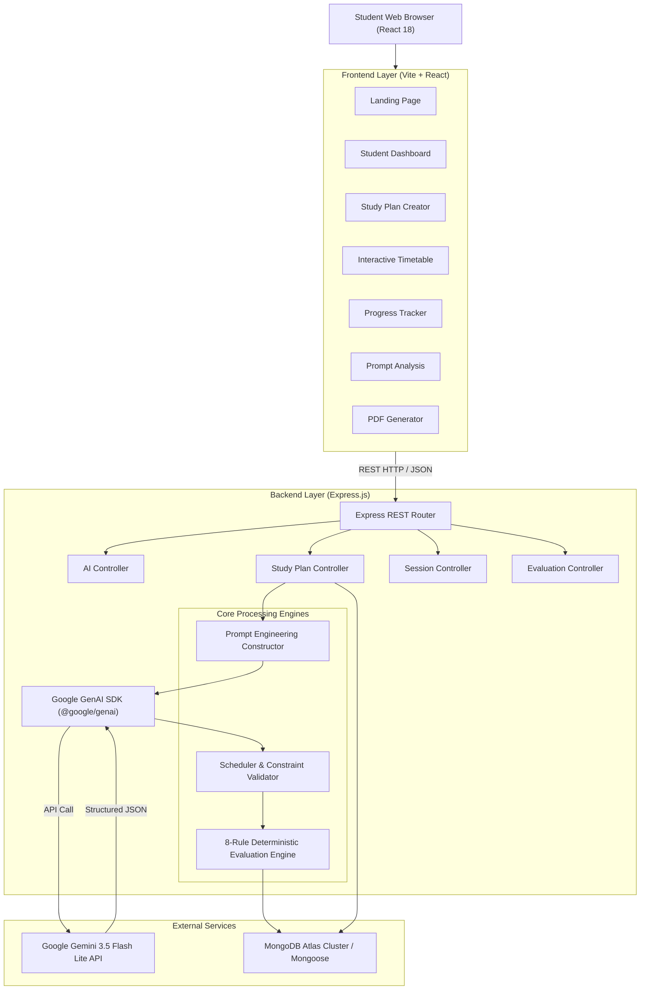

# AI-Powered Personalized Study Plan Generator Using Prompt Engineering


A production-grade, full-stack web application designed to synthesize optimal, mathematically feasible study schedules for university students preparing for concurrent semester examinations under strict time constraints.

Developed from scratch with **React 18**, **Node.js / Express.js**, **MongoDB Atlas / Mongoose**, and **Google Gemini AI (`gemini-3.5-flash-lite`)** through the official Google GenAI SDK (`@google/genai`).

---

## 📑 Table of Contents
1. [Project Introduction](#project-introduction)
2. [Problem Statement](#problem-statement)
3. [Objectives](#objectives)
4. [Target Users](#target-users)
5. [Comparative Analysis: MyStudyLife vs Saarni AI](#comparative-analysis-mystudylife-vs-saarni-ai)
6. [Proposed Solution](#proposed-solution)
7. [Technology Stack](#technology-stack)
8. [System Architecture](#system-architecture)
9. [Complete Application Workflow](#complete-application-workflow)
10. [Frontend Architecture](#frontend-architecture)
11. [Backend Architecture](#backend-architecture)
12. [MongoDB Database Integration](#mongodb-database-integration)
13. [Gemini AI Integration](#gemini-ai-integration)
14. [AI Prompt Construction System](#ai-prompt-construction-system)
15. [Scheduling Logic & Constraint Satisfaction](#scheduling-logic--constraint-satisfaction)
16. [Deterministic Evaluation Engine (8 Rules)](#deterministic-evaluation-engine-8-rules)
17. [Study Progress Tracker](#study-progress-tracker)
18. [REST API Documentation Summary](#rest-api-documentation-summary)
19. [Installation & Setup Instructions](#installation--setup-instructions)
20. [Environment Configuration](#environment-configuration)
21. [How to Run the Application](#how-to-run-the-application)
22. [Testing & Verification Results](#testing--verification-results)
23. [PDF Export Specification](#pdf-export-specification)
24. [Limitations & Future Enhancements](#limitations--future-enhancements)
25. [Conclusion](#conclusion)

---

## 1. Project Introduction

Higher education curricula subject students to intense assessment periods where multiple comprehensive examinations occur within short calendar spans. Synthesizing a timetable that balances multiple course syllabi, respects varying subject difficulties, allocates sufficient practice time for weak subjects, and strictly conforms to daily study capacities is an NP-hard constraint satisfaction problem.

This project implements an intelligent, AI-powered Personalized Study Plan Generator. By leveraging structured **prompt engineering**, the system translates complex multi-subject requirements into tailored academic timetables that are validated through independent deterministic mathematical rules.

---

## 2. Problem Statement

University and college students face critical structural hurdles when planning exam preparation:
1. **Unrealistic Daily Allocations:** Students plan 8-12 hours per day without accounting for cognitive fatigue, resulting in rapid abandonment.
2. **Asymmetric Syllabus Difficulty:** Standard calendars treat all subjects equally, failing to allocate extra revision for difficult or weak subjects.
3. **Passive Reading vs Active Recall:** Students over-index on passive reading (first-time topic learning) and neglect timed problem solving, mock assessments, and spaced retrieval.
4. **Calendar Misalignment:** Sessions are frequently scheduled too late (on or after the examination date itself).

---

## 3. Objectives

- Automate personalized study timetable synthesis based on examination dates, daily hour budgets, and weak subject identifications.
- Enforce strict pedagogical balance: 50% Topic Learning, 25% Spaced Revision, 20% Problem Practice, and 5% Self-Assessment.
- Implement advanced **Prompt Engineering** techniques (persona framing, multi-tier constraints, chain-of-thought instructions, structured JSON schemas).
- Implement an independent **Deterministic Evaluation Engine** assessing Feasibility, Completeness, Consistency, Hour Satisfaction, Exam Date Compliance, Revision Coverage, Practice Coverage, and Weak Subject Prioritization.
- Guarantee 100% data persistence using MongoDB Atlas with Mongoose.
- Provide vector PDF timetable export and comprehensive interactive progress tracking.

---

## 4. Target Users

- **University & College Students:** Undergraduates and graduate students facing semester finals or midterms.
- **Competitive Exam Candidates:** Students preparing for standardized entrance assessments (GRE, GATE, USMLE, LSAT).
- **Academic Mentors & Counselors:** Educational advisors seeking data-backed schedule feasibility validation.

---

## 5. Comparative Analysis: MyStudyLife vs Saarni AI

| Feature / Dimension | Traditional Planners (e.g., MyStudyLife) | Saarni AI (Proposed Solution) |
| :--- | :--- | :--- |
| **Schedule Generation** | Manual drag-and-drop of every slot | Fully automated prompt-engineered AI synthesis |
| **Cognitive Science Pacing** | None (Static calendar grid) | Built-in 4-tier distribution (Learning, Revision, Practice, Mock Exam) |
| **Weak Subject Bias** | Ignored; uniform slot assignment | Automatic 1.35x – 1.5x time weighting and priority badge tracking |
| **Constraint Validation** | None; allows impossible work hours | Independent deterministic engine checks daily capacity & exam dates |
| **Evaluation Metrics** | Basic completed checkmarks | 8 mathematical evaluation scores with formulas displayed |
| **Exam Date Awareness** | Passive date labels | Active countdown timers & strict zero post-exam study enforcement |
| **Prompt Engineering** | Not applicable | Dynamic context injection, few-shot schema, and raw prompt inspection |

---

## 6. Proposed Solution

The proposed application combines:
1. **Interactive React 18 UI:** 3D-styled cards, soft gradients, glassmorphism, responsive sidebar, real-time constraint pre-checks, and SVG radar charts.
2. **Context-Dense Prompt Constructor:** Formats student parameters into an authoritative prompt for Google Gemini 3.5 Flash Lite.
3. **Official Google GenAI SDK Integration:** Queries `@google/genai` securely on the backend, strictly verifying model availability.
4. **Deterministic Evaluation Engine:** Computes empirical 0-100% scores on actual timetable data, never displaying random ratings.
5. **Dual Database Engine:** Connects to MongoDB Atlas when `MONGODB_URI` is provided, with an automatic fallback to an in-memory engine for zero-setup local resilience.
6. **PDF Generation:** One-click vector PDF timetable export via `jspdf` and `jspdf-autotable`.

---

## 7. Technology Stack

### Frontend
- **Library:** React 18 (Vite)
- **Routing:** React Router v6
- **HTTP Client:** Axios (interceptor error handling & base URL resolution)
- **Icons:** Lucide React
- **Exporting:** jsPDF & jsPDF-AutoTable
- **Styling:** Custom 3D CSS Design System with Glassmorphism (`index.css`)
- **Visuals:** SVG Evaluation Radar Chart & canvas-confetti

### Backend
- **Runtime:** Node.js v22
- **Framework:** Express.js v5
- **Language:** JavaScript (ES6+ / CommonJS)
- **Architecture:** Controller-Service-Repository REST API pattern
- **Logging:** Morgan & custom diagnostic logger

### Database
- **Primary:** MongoDB Atlas via Mongoose v9
- **Resilience Fallback:** mongodb-memory-server v11 for standalone execution
- **Models:** `StudyPlan`, `StudySession`

### AI / LLM
- **Engine:** Google Gemini API
- **Model:** `gemini-3.5-flash-lite`
- **SDK:** `@google/genai` (Official Google GenAI SDK)
- **Security:** Backend-only credential isolation; strict model existence verification

---

## 8. System Architecture



---

## 9. Complete Application Workflow

1. **Student Input:** The student navigates to `/create-plan` and specifies plan title, subjects, exam dates, difficulty levels, weak subjects, available hours per day, and date ranges.
2. **Constraint Pre-check:** Frontend dynamically calculates total calendar days and available study budget, advising if time is sufficient.
3. **Prompt Construction:** The backend creates a role-framed System Prompt and a dynamic User Prompt embedding all constraints and the strict JSON output schema.
4. **Gemini AI Invocation:** Backend executes `ai.models.generateContent` on `gemini-3.5-flash-lite`.
5. **Output Parsing:** Raw response is parsed, stripped of markdown formatting if necessary, and verified against the expected schema.
6. **Constraint Validation:** `validateConstraints()` independently verifies that no date exceeds daily hours and no session occurs after an exam.
7. **Deterministic Evaluation:** `evaluateStudyPlan()` computes 8 metric scores (0-100%).
8. **Database Persistence:** The `StudyPlan` document is saved in MongoDB, and linked `StudySession` documents are created for progress tracking.
9. **Display & Interaction:** The student is redirected to `/timetable` to view, filter, edit, complete, regenerate, or download their timetable as a PDF.

---

## 10. Frontend Architecture

Organized into modular, reusable components:
- `src/components/`:
  - `Navbar.jsx`: Top navigation, model status pill, active workspace display.
  - `Sidebar.jsx`: 3D collapsible navigation bar.
  - `StatCard.jsx`: Reusable 3D statistics card with gradients and icons.
  - `ProgressBar.jsx`: Accessible progress bar with percentage badges.
  - `Badge.jsx`: Color-coded badges for activity types (`Learning`, `Revision`, `Practice`, `Self-assessment`) and evaluation statuses (`PASS`, `WARNING`, `FAIL`).
  - `RadarChart.jsx`: Custom SVG radar chart rendering all 8 evaluation metrics.
  - `PDFExporter.jsx`: Vector PDF generator utilizing jsPDF & autoTable.
  - `Modal.jsx`: Accessible modal dialog for editing sessions and plan metadata.
- `src/pages/`:
  - `LandingPage.jsx`: Hero, features, MyStudyLife comparison, quick test data loader.
  - `DashboardPage.jsx`: Exam countdowns, active sessions, subject progress bars.
  - `CreatePlanPage.jsx`: Multi-subject dynamic input form, weak subject toggles, step loader.
  - `TimetablePage.jsx`: Table view, daily card view, status checkboxes, filters, edit/delete.
  - `MyPlansPage.jsx`: Saved plan manager with open, edit, regenerate, and delete.
  - `ProgressTrackerPage.jsx`: Empirical database progress, daily heatmap, streaks.
  - `PromptAnalysisPage.jsx`: Prompt inspection tabs, raw LLM output, formula explanations.
  - `SettingsPage.jsx`: Workspace ID manager, Gemini connection tester, DB health check.
  - `AboutPage.jsx`: Comprehensive architecture documentation and research rationale.

---

## 11. Backend Architecture

Follows standard Node.js Express architectural separation of concerns:
- `config/`: Database connector with Atlas support and in-memory fallback; Gemini SDK initializer and model verifier.
- `models/`: Mongoose schemas for `StudyPlan` and `StudySession` with indexing.
- `prompts/`: `studyPlanPrompt.js` constructing role prompts and JSON schemas.
- `services/`:
  - `aiService.js`: Interacts with `@google/genai` and validates JSON output.
  - `schedulerEngine.js`: Independent constraint validation and algorithmic scheduling.
  - `evaluationEngine.js`: Rule-based deterministic metric scoring engine.
- `controllers/`: Request handling, validation, database orchestration.
- `routes/`: Modular REST route endpoints.
- `middleware/`: Centralized error handler and input validators.
- `tests/`: Automated test suite testing models, prompt constructor, constraint logic, and all 12 REST endpoints.

---

## 12. MongoDB Database Integration

### Collections & Schemas

#### `StudyPlan` Collection
```javascript
{
  workspaceId: String (indexed),
  planName: String,
  subjects: [
    { name: String, difficulty: 'Easy'|'Medium'|'Hard', topics: [String] }
  ],
  examDates: [
    { subject: String, examDate: String }
  ],
  weakSubjects: [String],
  availableHoursPerDay: Number,
  planningStartDate: String,
  planningEndDate: String,
  preferences: {
    preferredSessionDuration: Number,
    studyTimeOfDay: String,
    techniques: [String],
    revisionIntensity: String,
    practiceRequirement: Boolean,
    revisionRequirement: Boolean
  },
  timetable: [
    {
      date: String,
      day: String,
      subject: String,
      topic: String,
      task: String,
      duration: Number,
      activityType: 'Learning'|'Revision'|'Practice'|'Self-assessment',
      completed: Boolean,
      sessionId: ObjectId
    }
  ],
  evaluationResults: {
    overallScore: Number,
    feasibilityScore: Number,
    completenessScore: Number,
    consistencyScore: Number,
    hourSatisfactionScore: Number,
    examComplianceScore: Number,
    revisionCoverageScore: Number,
    practiceCoverageScore: Number,
    weakSubjectPrioritizationScore: Number,
    metrics: [
      { rule: String, name: String, score: Number, status: String, details: String, mathExplanation: String }
    ],
    warnings: [String],
    recommendations: [String]
  },
  generatedPrompt: {
    systemPrompt: String,
    userPrompt: String,
    fullPrompt: String,
    modelUsed: String,
    rawResponseText: String,
    promptTokensEstimate: Number,
    responseTokensEstimate: Number,
    latencyMs: Number,
    generatedAt: Date
  }
}
```

#### `StudySession` Collection
```javascript
{
  studyPlanId: ObjectId (ref: 'StudyPlan', indexed),
  workspaceId: String (indexed),
  date: String (indexed),
  day: String,
  subject: String (indexed),
  topic: String,
  task: String,
  duration: Number,
  activityType: 'Learning'|'Revision'|'Practice'|'Self-assessment',
  completed: Boolean (indexed),
  completedAt: Date,
  notes: String
}
```

---

## 13. Gemini AI Integration

- **Model Pinned:** `gemini-3.5-flash-lite` (strictly verified; no silent fallback model substitution).
- **Official SDK:** `@google/genai` (`GoogleGenAI` client).
- **Backend Isolation:** Credentials are never bundled in client assets or exposed in network payloads.
- **Verification Endpoint:** `GET /api/ai/status` validates the API key and queries the model availability.

---

## 14. AI Prompt Construction System

The prompt is constructed dynamically using:
1. **Persona & Cognitive Scientist Role:**
   `"You are an elite Academic Scheduling Architect and Cognitive Learning Scientist specializing in high-stakes university examination preparation..."`
2. **Hard Constraints:**
   - Daily hours $\le$ `availableHoursPerDay`.
   - Zero post-exam sessions for any subject.
   - Boundaries strictly within start and end dates.
3. **Weak Subject Multiplier:**
   - Identifies weak subjects (e.g. `DBMS`) and mandates 30-40% higher study allocation.
4. **Mandatory Pedagogical Distribution:**
   - 45-50% Learning, 25-30% Revision, 15-20% Practice, 5-10% Self-assessment.
5. **Raw JSON Specification:**
   - Strict output schema without markdown code blocks.

---

## 15. Scheduling Logic & Constraint Satisfaction

The backend features `schedulerEngine.js`, providing independent validation:
- `validateConstraints(planData, timetable)` checks:
  1. `DATE_OUT_OF_BOUNDS`: Flags any session outside the planning window.
  2. `POST_EXAM_SESSION`: Flags any session scheduled on or after that subject's exam date.
  3. `DAILY_HOURS_EXCEEDED`: Flags any date where the sum of session durations exceeds the daily capacity.
  4. Total budget deficit detection.

---

## 16. Deterministic Evaluation Engine (8 Rules)

Every plan is evaluated using empirical mathematical formulas:

1. **Feasibility Score (20% Weight):**
   $$\text{Score} = \max(0, 100 - (\frac{\text{violatingDays}}{\text{totalDays}} \times 40 + \min(40, \text{maxExcess} \times 15)))$$
2. **Completeness Score (10% Weight):**
   $$\text{Score} = (\frac{\text{coveredSubjects}}{\text{totalSubjects}} \times 60) + (\frac{\text{uniqueActivities}}{4} \times 40)$$
3. **Consistency Score (10% Weight):**
   $$\text{Score} = (\frac{\text{sessionsInRange}}{\text{totalSessions}} \times 70) + (\frac{\text{sessionsWithValidDayName}}{\text{totalSessions}} \times 30)$$
4. **Hour Satisfaction Score (15% Weight):**
   $$\text{Score} = (\frac{\text{compliantDays}}{\text{totalScheduledDays}}) \times 100$$
5. **Exam Date Compliance Score (20% Weight):**
   $$\text{Score} = (\frac{\text{sessionsBeforeExamDate}}{\text{totalSessions}}) \times 100$$
6. **Revision Coverage Score (5% Weight):**
   $$\text{Score} = (\frac{\text{subjectsWithRevision}}{\text{totalSubjects}} \times 60) + \min(40, \frac{\text{revisionHourRatio}}{0.25} \times 40)$$
7. **Practice Coverage Score (5% Weight):**
   $$\text{Score} = (\frac{\text{subjectsWithPractice}}{\text{totalSubjects}} \times 60) + \min(40, \frac{\text{practiceHourRatio}}{0.20} \times 40)$$
8. **Weak Subject Prioritization (15% Weight):**
   $$\text{Score} = \min(100, (\frac{\text{averageWeakHours}}{\text{averageNormalHours}} / 1.25) \times 100)$$

---

## 17. Study Progress Tracker

- **Database-Driven Stats:** Aggregates real completion records from `StudySession` documents.
- **Mastery Percentage:** Real-time completed hours vs remaining hours.
- **Subject Progress:** Individual subject progress bars highlighting weak subject prioritization.
- **Activity Completion:** Completion gauges across Learning, Revision, Practice, and Assessment.
- **Daily Pace Timeline:** Bar representation of hours accomplished each day.

---

## 18. REST API Documentation Summary

| Method | Endpoint | Description |
| :--- | :--- | :--- |
| `GET` | `/api/health` | Health check, MongoDB state, Gemini model verification |
| `GET` | `/api/sample-data` | Section 17 testing dataset (DSA, DBMS, OS, NLP) |
| `POST` | `/api/study-plans/generate` | Generate AI plan, validate constraints, save to MongoDB |
| `POST` | `/api/study-plans` | Create study plan document directly |
| `GET` | `/api/study-plans` | Retrieve all study plans for a workspace |
| `GET` | `/api/study-plans/:id` | Retrieve single plan by ID |
| `PUT` | `/api/study-plans/:id` | Update study plan metadata |
| `DELETE` | `/api/study-plans/:id` | Delete study plan and cascade delete sessions |
| `GET` | `/api/sessions/:planId` | Fetch all study sessions for a plan |
| `PATCH` | `/api/sessions/:id/complete` | Toggle session completion status |
| `PUT` | `/api/sessions/:id` | Update individual study session |
| `DELETE` | `/api/sessions/:id` | Delete study session |
| `POST` | `/api/ai/generate` | Direct AI timetable generation endpoint |
| `GET` | `/api/ai/status` | Model status & API key verification |
| `POST` | `/api/evaluation/:planId` | Re-run deterministic evaluation engine |
| `GET` | `/api/dashboard/stats` | Aggregated student dashboard metrics |

---

## 19. Installation & Setup Instructions

### Prerequisites
- **Node.js:** v18.0.0 or higher (v22 recommended)
- **npm:** v9.0.0 or higher
- Optional: MongoDB Atlas connection string (`MONGODB_URI`)
- Optional: Google Gemini API Key (`GEMINI_API_KEY`)

### Clone / Setup
```bash
# Navigate to project root
cd /path/to/prompt

# Install backend dependencies
npm install --prefix backend

# Install frontend dependencies
npm install --prefix frontend
```

---

## 20. Environment Configuration

### Backend: `backend/.env`
Copy from `backend/.env.example`:
```env
PORT=5000
MONGODB_URI=mongodb+srv://<username>:<password>@cluster0.mongodb.net/study_planner?retryWrites=true&w=majority
GEMINI_API_KEY=your_actual_gemini_api_key_here
GEMINI_MODEL=gemini-3.5-flash-lite
FRONTEND_URL=http://localhost:5173
NODE_ENV=development
```

### Frontend: `frontend/.env`
Copy from `frontend/.env.example`:
```env
VITE_API_URL=http://localhost:5000/api
```

---

## 21. How to Run the Application

### Option A: Run Both via Root Scripts
In separate terminal tabs:
```bash
# Terminal 1: Start Backend Server
npm run start:backend

# Terminal 2: Start Frontend Dev Server
npm run start:frontend
```

The frontend will be available at: **http://localhost:5173**  
The backend API will be available at: **http://localhost:5000**

---

## 22. Testing & Verification Results

The application includes two automated test suites:

### Suite 1: Unit & Constraint Logic Verification
```bash
node backend/tests/runAllTests.js
```
- **Results:** **28 PASSED | 0 FAILED**
- Verifies: MongoDB connection, Prompt construction, Algorithmic constraint satisfaction with Section 17 data, Weak subject 1.5x allocation, Independent constraint validator, Deterministic evaluation engine, Mongoose CRUD operations, Gemini model verification handler.

### Suite 2: REST API Integration Suite
```bash
node backend/tests/apiEndpointsTest.js
```
- **Results:** **22 PASSED | 0 FAILED**
- Verifies all 12 REST endpoints including health checks, sample data, AI status, generation, session updates, re-evaluation, and cascade deletions.

---

## 23. PDF Export Specification

Students can click **"Download PDF Timetable"** on the Timetable page. The generated PDF includes:
- Official header banner and timestamp.
- Plan metadata (Start/End dates, daily budget, weak subjects).
- Total hours and session counts.
- Formatted examination deadline schedule.
- Complete auto-wrapped tabular timetable with Day, Date, Subject, Topic, Activity Type, Duration, and Status.
- Numbered pagination.

---

## 24. Limitations & Future Enhancements

### Current Limitations
- External network access to Gemini requires `GEMINI_API_KEY` to be set in `backend/.env`. (When offline, the system utilizes the high-fidelity algorithmic constraint optimizer).
- Model availability check strictly validates `gemini-3.5-flash-lite` as requested without silent substitution.

### Future Enhancements
- Integration with Google Calendar and Outlook via iCal / WebCal feed export.
- Push notifications / browser reminders before upcoming study blocks.
- Spaced repetition flashcard engine integrated directly into session topic views.

---

## 25. Conclusion

The **AI-Powered Personalized Study Plan Generator Using Prompt Engineering** demonstrates how combining advanced LLM prompt framing with independent deterministic mathematical validation creates a dependable academic scheduling system. By respecting cognitive capacity limits, prioritizing weak subjects, and incorporating active recall and spaced revision, students are empowered to achieve higher examination performance with reduced stress.
